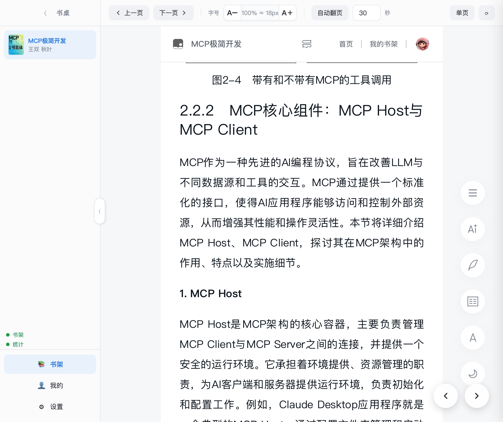
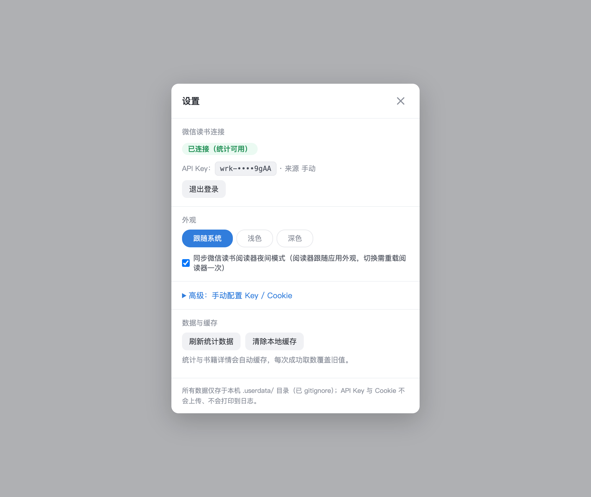
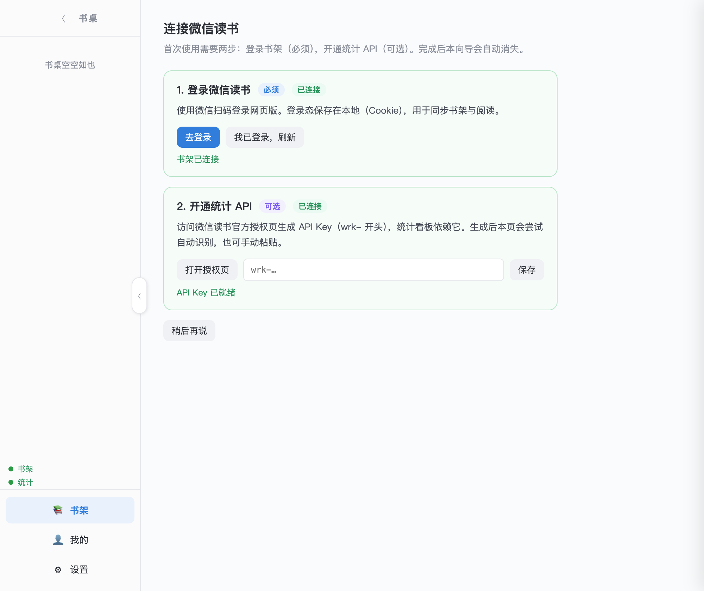

# 我给微信读书写了个桌面壳，然后发现正文根本不在 DOM 里

> 一个 Electron 小项目的开源复盘：从「字号能不能再小一点」出发，一路踩到 canvas 渲染、跨屏 DPR、夜间模式 cookie 和「合成点击无效」这些反直觉的坑。

## 起因：两个很小的难受

网页版微信读书日常够用，但有两件事一直硌得慌：

1. **最小字号还是太大。** 字号滑块最小一级 18px，再往小没有档位。我想在摸鱼……不是，想在有限窗口里塞下更多字。
2. **没有 PC 客户端。** 只能挂在浏览器标签页里，Alt+Tab 一不小心就暴露。

需求小到不值得等官方。于是用 Electron + webview 套一层网页版——这两件事都能就地解决。后来顺手把书桌、书架、统计做成了原生界面，日常阅读不再面对一坨网页 UI。

项目开源在 [github.com/happut/weread-pc](https://github.com/happut/weread-pc)，MIT，零运行时第三方依赖。下面挑几个最有意思的坑讲讲。

## 坑一：改字号这件事，原理上就不可能用 CSS 实现

第一版按常规思路注入样式覆盖正文字号：

```css
.readerContent p { font-size: 14px !important; }
```

结果：**章节标题变了，正文纹丝不动。**

我不信邪，写了个探针抓真实 DOM：

```
pCount: 0                          // 正文里一个 <p> 都没有
canvasCount: 2                     // 两个 canvas，1228×3366，CSS 宽度 614px
bodyInnerText.length: 69           // 整页文本只有 69 个字，全是「首页/我的书架/上一章」
```

真相是：**正文渲染在 canvas 上**，DOM 里根本没有正文字符。canvas 是位图，不吃 CSS 排版。你改 `font-size` 改的是空气。

这也解释了为什么网页版微信读书**无法选中复制、无法划词划线**——文字压根不是文本节点。

那只能缩放。但缩放也有坑：

- 直接用 `webContents.setZoomFactor(0.9)`，DPR 会变成非整数（2 → 1.8）。微信读书按像素坐标画字，小数缩放下**字形错位**，糊成一团。
- 最终方案：只给 canvas 页容器加 CSS `zoom`：

```css
.wr_canvasContainer { zoom: 0.9 !important; }
```

位图等比缩放，DPR 不变，不会乱码；阅读器工具栏字号也不跟着缩。50%–200% 连续可调，比官方最小号还能小。



**教训：先确认你要改的东西到底在不在你以为的那一层。** 我差点在一个没有 `<p>` 的页面上调半天 CSS。

## 坑二：把窗口拖到另一块屏幕，字就花了

正文是 canvas 位图，画好就定格。窗口从 Retina 屏拖到外接 1080p 屏，`devicePixelRatio` 变了，但**已画好的 canvas 不会自动重绘**——字形错位。

修法不优雅但有效：监听窗口 `moved`，比对显示器 ID，换屏后延迟派发一个 `resize` 事件，再把窗口高度抖动 1px，逼阅读器重新排版：

```js
win.on('moved', () => {
  const d = screen.getDisplayMatching(win.getBounds());
  if (d.id !== lastDisplayId) {
    lastDisplayId = d.id;
    setTimeout(forceRerender, 250); // 等系统完成 DPR 切换
  }
});
```

工具条还留了个 `⟳` 手动重绘兜底。这种「逼第三方页面重排」的活儿，没有官方 API 可用，只能靠观察它的触发条件反推。

## 坑三：夜间模式是个 cookie，还藏了两份

我想让应用切深色时，微信读书阅读器也跟着进夜间。第一反应：写 `localStorage`。

没用。站点重载后照样回白色。

扒了它的 bundle 才发现，主题常量 `COOKIE_THEME` 指向的是 **cookie `wr_theme`**，不是 localStorage。只写 localStorage，站点重载后读 cookie 回退白色。

改成写 cookie 后又掉进第二个陷阱：**无限重载**。原来 cookie 有 host 级和 domain 级两份旧值，写入前没清干净，站点反复读到不一致的值，reload 停不下来。

最终的稳定方案叠了四层：

1. 比对 / 写入 cookie，同时镜像一份 localStorage；
2. 写入前清 host / domain 双级旧 cookie；
3. 「是不是阅读页」的判断放进 guest 脚本里做——宿主重载后 `getURL` 不可靠；
4. 同一目标值每页只注入一次，消除并发重复 reload。

一个「换个主题色」的需求，最后是个状态同步去重问题。**而且我坚持不注入 CSS 覆盖**，而是写站点自己的 `wr_theme`，等同点它自己的夜间按钮——这样官方改版时我不容易碎。



## 坑四：合成 `.click()` 点不动阅读页的按钮

阅读页有些控件无视 `element.click()`。原因是它监听的是真实用户输入，合成事件的 `isTrusted` 是 `false`，被它过滤了。

解法是走主进程，向 webview 注入**真实鼠标事件**：

```js
g.sendInputEvent({ type: 'mouseMove', x, y });
g.sendInputEvent({ type: 'mouseDown', x, y, button: 'left', clickCount: 1 });
g.sendInputEvent({ type: 'mouseUp',   x, y, button: 'left', clickCount: 1 });
```

`sendInputEvent` 产生的是 `isTrusted: true` 的事件，和真鼠标无异。唤出会自动隐藏的工具栏也是同理——注入一次真实 `mouseMove`。

## 一个灰色地带：阅读时长

Electron 默认 UA 带 `Electron/xx` 和应用名，微信读书识别为非标准客户端后**不计阅读时长**。我把 UA 伪装成标准桌面 Chrome，时长才正常上报。

这点我在 README 和代码注释里都写明了：它属微信读书 ToS 的灰色地带，使用者自行评估。开源项目把这种事藏着掖着没意义，摊开讲反而省事。

## 架构上几个刻意的选择

- **多书保活**：每本打开过的书一个独立 webview，切书不重载，进度和画布原样保留。切回上一本不用等它重新画 canvas。
- **纯函数 VM + 单测**：书架、统计、详情、认证路由都抽成纯函数视图模型，配 `node:test`，62 个用例。UI 再花，数据逻辑是可测的。
- **零运行时第三方依赖**：只用 Electron 内置模块。打包不依赖 electron-builder——脚本把官方预编译运行时拿来，注入源码即可。这次开源顺手把 `build.sh` 重写成跨平台，一条 `npm run build:all` 出 macOS arm64/x64、Windows、Linux 四个包。
- **隐私本地化**：登录态走 webview 持久分区，API Key 落本地明文 JSON，不上传不入库。`.gitignore` 覆盖全部用户数据，仓库里一个真实凭据都没有，测试 fixture 全是合成数据。

## 开源前我检查了什么

决定发出来之前，我过了一遍：

- 仓库里有没有混进真实 Cookie / Key / 个人书架数据？——没有，fixture 是「书一 / 甲乙丙丁」。
- 别人 clone 默认分支拿到的是不是最新代码？——发现最新体验改进还在 feature 分支没合，先合并、升版本、对齐 README。
- Release 是不是只有源码没有产物？——补上四平台可下载 zip。
- 哪些包是真验证过的？——只有 macOS arm64 在本机跑通了「启动 → 壳 UI → webview 到达书架」；其余是同源交叉构建，结构一致但没在对应系统实测。这点我在发布说明里如实标注，不装成全都测过。

最后一条尤其重要。开源的可信度不在于「我全测了」，而在于**我清楚自己测了什么、没测什么，并且告诉你**。

## 已知限制（不藏着）

- 正文 canvas 渲染，无法选中复制、无法划词划线。
- 依赖网页版内部类名（`.wr_canvasContainer` 等），官方改版可能要改选择器。
- 统计走非官方网关，`skill_version` 做了自动跟随，但接口语义变了仍要改代码。
- 界面以 macOS 为第一公民，Windows/Linux 能跑但标题栏拖拽区没逐平台精修；Linux 便携包要 `--no-sandbox` 启动。

## 首次连接长这样

两步向导：扫码登录书架（必须）、开通统计 API（可选）。登录态走 webview 持久分区，Key 落本地明文 JSON，都不上传。



## 写在最后

这个项目最大的收获不是「做了个客户端」，而是那个探针打印出 `pCount: 0` 的瞬间——**你以为的 DOM，可能根本不存在**。很多「调半天没效果」的 bug，根因都是你在错误的那一层使劲。

如果你也想要一个字号能更小、能自动翻页、书桌书架像原生客户端的微信读书桌面版，欢迎来 [仓库](https://github.com/happut/weread-pc) 下载或拍砖。Apple Silicon 之外平台的实测反馈，尤其欢迎。